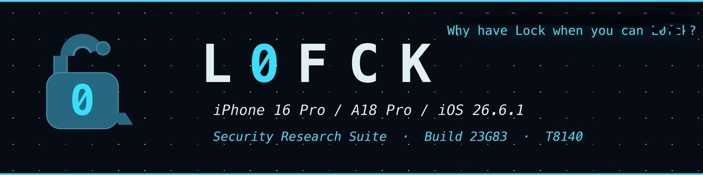

<br>
<br>

<br>

<p align="center">
  
  
</p>

<br>

<p align="center">
  
  
  
  
  
</p>

</div>

**`l0fck`** is a standalone, clean-slate security research and activation analysis tool purpose-built for the **iPhone 16 Pro & iPhone 16 Pro Max** (Apple A18 Pro SoC, CPID `0x8140`, `iPhone17,1` / `iPhone17,2`) running **iOS 26.6.1** (Build `23G83`).

> ### ⚠️ Research only — do not use off-target
> **Everything in this repository is for defensive and academic research
> purposes only.** All work has been **lab-tested in a secure, isolated
> environment**. **Do not use this research to build custom attack chains.**
> **Do not run this program in an unsecured environment or against a device
> you do not own and are not authorized to test.**

---

## Key Highlights & Vulnerability Vectors

1. **Port DFU (`05ac:f014`) Native Descriptor Parsing**:
   Starting with iPhone 15 & 16 USB-C series, Apple replaced legacy SecureROM DFU (`05ac:1227`) with Port DFU (`05ac:f014`). `l0fck` properly extracts `SDOM`, `SYSI`, `BDID`, `CPID` (`0x8140`), `ECID`, `SRTG`, and `CHIP` without control transfer pipe stalls.
2. **Unauthenticated Lockdown & Sensitive Services (Vulnerability #02)**:
   Exposes sensitive endpoints directly through `lockdownd_client_new()` without requiring pairing records or device trust prompts (`com.apple.afc` for media partition R/W, `com.apple.mobile.diagnostics_relay` for reboot, `com.apple.syslog_relay`, `com.apple.os_trace_relay`, and `com.apple.mobile.notification_proxy`).
3. **Lockdown SSL Bypass & Host Trust Traversal (Vulnerability #03)**:
   Bypasses the untrusted host blocklist via `IgnoreUntrustedList=true` option dictionary injection, performs HostID path traversal to load arbitrary pair records without `..` restriction (bypassing 30-day expiry), and establishes unauthenticated SSL sessions combining custom SSL trust-anchor validation bypass.
4. **Preboard Service Exploitation (Vulnerability #23)**:
   Unauthenticated probing of `com.apple.preboardservice_v2` with crafted stashbag manifests triggering service crashes.
5. **iOS 26.6.1 MobileActivation & Albert DRM Protocol**:
   Implements full IngestBody / CollectionBlob decoding, Albert DRM handshake proxying (`https://albert.apple.com/deviceservices/drmHandshake`), 5-stage online activation pipeline, and offline A18 Pro activation record synthesis.
6. **Persistent PurpleBuddy & Flag Injection**:
   Injects configuration keys (`PurpleBuddy`, `SkipSetup`, `allow-hactivation`, `FDRForceLegacySigning`, `FillmoreBypassOTDataPersist`) plus expanded `com.apple.springboard`, `com.apple.SetupAssistant`, and `com.apple.purplebuddy` keys directly into lockdown storage.
7. **Local Captive Portal & WebSheet Research Assistant**:
   Full-featured multi-threaded DNS spoofer, CNA probe handler (`/hotspot-detect.html`), WebSheet JavaScript telemetry harvester, URL scheme fuzzer (`prefs:`, `diags:`, `shoebox:`, `itms-services:`), dynamic `.mobileconfig` / Root CA exporter, OpenSSL TLS pinning inspector, host web dashboard (`/admin`), AppleAVE2 portal telemetry endpoint (`/api/appleave2-result`), and KRW HTTP C2 bridge (`/api/krw/cmd`, `/api/krw/result`).
8. **Neo-Chain Kernel Exploitation Framework**:
   Unified kernel exploit orchestration for A18 Pro. Primary path: **AppleAVE2 CVE-2026-84607 eEncType race condition**; fallback: V-047 AppleJPEGDriver OOB write, AppleMCCUserClientV2 testMode, or PMAP TTE-remove PUAF+reclaim. Integrates AMFI/CoreTrust bypass via `trust_cache_rt` injection (with PAC pointer stripping and writable cave discovery), SEP/NVRAM write via PMAP, and proc enumeration via `allproc`. Uses verified iOS 26.6.1 T8140 offsets from `kernel-deltas/state/t8140/26.6.1-23G83.txt`.
9. **SetupAssistant-Chain (Wi-Fi Portal & AppleAVE2 Video Kernel Exploit)**:
   Pure over-the-air exploit chain for unactivated devices in Setup Assistant. No USB cable required. Launches captive DNS/HTTP/TLS servers to intercept Apple CNA probes, pops up WebSheet, and runs WebCodecs `VideoEncoder` race to trigger `AppleAVE2Driver` `sEnc.eType`/`eEncType` state desynchronization (CVE-2026-84607) directly from the captive browser context. On kernel R/W win: injects CoreTrust trust cache, disarms AMFI/SEP, transitions CNA to success, serves synthesized activation record, and optionally (on USB attach) injects flags + stages preferences + dispatches Darwin dismissal notifications → unlocked Home Screen.
10. **Sovereign-Chain & Sovereign-Lite Hybrid Bypass**:
    Userspace security-degradation chains that apply dual-vector memory pressure (NECP + IOSurface) and AI guardrail AFC overrides before activation bypass. Sovereign-Chain runs the full 5-stage bypass; Sovereign-Lite pivots to lockdown injection, notification burst, and respring without activation/race stages.
 11. **On-Device Payload Framework (V-047, PMAP, AppleAVE2)**:
     Cross-compilation and orchestration of on-device payloads for iOS 26.6.1 A18 Pro. Builds `.app` bundles via `iphoneos` SDK, stages to device via AFC, and polls result plists for kernel R/W readiness. Includes V-047 (AppleJPEGDriver OOB groom/fire), PMAP (pmap_tte_remove PUAF/reclaim), and AppleAVE2 (eEncType race) payloads.
 12. **Restore-Chain (MobileBackup2 Restore-Staging Traversal, CVE-2026-84598 class)**:
     USB-only (no Wi-Fi, no kernel exploit) chain that drives a full `com.apple.mobilebackup2` restore session over lockdown: DL version exchange → `Hello` (SupportedProtocolVersions `[2.0, 2.1]`) → serves a synthesized `Manifest.plist` (Version `8.0`, `SystemDomainsVersion` `19.0`) → streams a synthesized `.mbdb` whose phase-1 entries use domain escapes (`SysContainerDomain-../..`) to stage canary files at the `/var/mobile/Media` in-jail root and `/var/tmp`, and phase-2 entries plant purplebuddy / SetupAssistant unlock plists. A hard gate re-reads the phase-1 canary over plain AFC before any unlock stage runs (parse-accept alone is not a write primitive); on confirmation it reuses the proven post-exploit stack (flag injection, offline activation, Darwin dismissal burst, respring) to reach the unlocked Home Screen.

---

## Architecture Diagram

```mermaid
graph TD
    A[l0fck CLI / start.sh] --> B{Device State Detection}
    B -->|PID 0x05ac:0xf014| C[Port DFU Engine]
    B -->|PID 0x05ac:0x1281| D[Recovery Mode Engine]
    B -->|PID 0x05ac:0x12a8| E[Normal Lockdown Engine]
    
    C --> C1[Port DFU Serial Parser: SDOM/SYSI/CPID 0x8140]
    C --> C2[Port Controller Safe Reset]
    
    E --> F[Target Verifier: A18 Pro / iOS 26.6.1]
    F --> G[Unauthenticated Lockdown Client]
    G --> G1[Lockdown SSL Bypass & Host Trust Traversal]
    
    G --> H1[AFC Media Partition Manager]
    G --> H2[Diagnostics Relay Controller]
    G --> H3[Syslog & OS Trace Streamer]
    G --> H4[PurpleBuddy Flag Injector]
    G --> H5[Preboard Service PoC #23]
    G --> H6[MobileActivation 26.6.1 & Albert DRM Engine]
    
    H6 --> I1[IngestBody & CollectionBlob Decoder]
    H6 --> I2[Online Albert Handshake Proxy]
    H6 --> I3[Offline A18 Pro Record Synthesizer]

    A --> J[WiFi Captive & WebSheet Suite]
    J --> J1[DNS Spoofer :53 / :5353]
    J --> J2[HTTP Captive Server :80 / :8080]
    J --> J3[TLS Pinning Inspector :443 / :8443]
    J --> J4[Host Admin Dashboard /admin]
    J --> J5[AppleAVE2 Portal Telemetry /api/appleave2-result]
    J --> J6[KRW HTTP C2 Bridge /api/krw/cmd + /api/krw/result]

    A --> K[Advanced Bypass Chains]
    K --> K1[Bypass-Full: 5-Stage TOCTOU Chain]
    K --> K2[Sovereign-Chain: Memory Pressure + Bypass]
    K --> K3[Sovereign-Lite: Injection + Notification]
    K --> K4[Neo-Chain: Kernel R/W + AMFI + SEP]
    K --> K5[SetupAssistant-Chain: Wi-Fi Portal + AppleAVE2]
    K --> K6[Restore-Chain: MobileBackup2 Restore-Staging Traversal]

    K4 --> L1[AppleAVE2 CVE-2026-84607 eEncType Race]
    K4 --> L2[AppleJPEGDriver V-047 OOB]
    K4 --> L3[AppleMCCUserClientV2 TestMode]
    K4 --> L4[PMAP TTE-Remove PUAF + Reclaim]
    K4 --> L5[trust_cache_rt Cave Injection]
    K4 --> L6[NVRAM Write via PMAP]

    K5 --> M1[Captive DNS/HTTP/TLS Intercept]
    K5 --> M2[WebSheet WebCodecs VideoEncoder Race]
    K5 --> M3[Over-The-Air Telemetry & kbase Leak]
    K5 --> M4["Post-Exploit: AMFI/SEP + CNA Success + Activation"]

    K6 --> P1[MB2 Session: DL version + Hello 2.0/2.1]
    K6 --> P2[Manifest.plist 8.0 + .mbdb domain-escape stream]
    K6 --> P3[211 Find My Gate retry + wedge recovery]
    K6 --> P4[Hard Gate: plain-AFC canary = confirmed write]
    K6 --> P5["Post-Exploit: flags + offline activation + Darwin burst + respring"]

    A --> N[On-Device Payloads]
    N --> N1[V-047 Payload: check/groom/fire/full]
    N --> N2[PMAP Payload: check/prove/reclaim/full]
    N --> N3[AppleAVE2 Payload: eEncType race]
    N --> N4[WebSheet Probes: JS telemetry & capability audit]
```



---

## Hardware Target Specifications

| Parameter | Value |
|---|---|
| **SoC** | Apple A18 Pro (`T8140`) |
| **Chip ID (CPID)** | `0x8140` |
| **Target Models** | `iPhone17,1` (iPhone 16 Pro), `iPhone17,2` (iPhone 16 Pro Max) |
| **Target OS Version** | `iOS 26.6.1` |
| **Target Build Version** | `23G83` |
| **Port DFU USB VID/PID** | `05AC:F014` |
| **Normal Lockdown USB VID/PID** | `05AC:12A8` |
| **Kernel Offset Source** | `kernel-deltas/state/t8140/26.6.1-23G83.txt` |

---

## Directory Structure

```
l0fck/
├── Makefile                          # Build configuration linking libimobiledevice, libusb, openssl, curl
├── README.md                         # Technical documentation
├── img/                              # README branding (logo, banner, shields) — cyan accent
│   ├── logo.png                      # l0fck logo (open padlock + wordmark)
│   ├── banner.png                    # Hero banner (title + slogan + specs)
│   └── badge-*.png                   # Research-only / lab-tested / target / hw / self-test shields
├── patch_mock.py                     # Runtime plist mock patching utility
├── start.sh                          # Interactive grouped terminal menu with confirmation screens
├── RESEARCH/                         # Chain & findings reference (read before implementing changes)
│   ├── README.md                     # Index: chains, findings, conventions, provenance
│   ├── chain-bypass-full.md          # Bypass-Full 5-stage TOCTOU chain
│   ├── chain-sovereign.md            # Sovereign-Chain / Sovereign-Lite
│   ├── chain-neo-chain.md            # Neo-Chain kernel R/W framework
│   ├── chain-setup-assistant.md      # SetupAssistant-Chain (Wi-Fi only)
│   ├── chain-glyphgrift.md           # GlyphGrift-Chain (CVE-2026-86950)
│   ├── chain-restore-chain.md        # Restore-Chain (MB2 restore-staging) + A18 Pro close-out
│   ├── findings-kernel-rw-hardening.md  # Winning primitive + Stage-6 hardening
│   ├── findings-kernel-offsets.md    # 26.6.1 T8140 offsets, recovered/blocked, promotion rules
│   ├── findings-preboard-vul23.md    # Preboard PoC/triage + D1 dead-end
│   ├── findings-lockdown-ssl-bypass.md  # Unauthenticated lockdownd SSL/trust traversal
│   ├── findings-activation-ambit.md  # SEP nonce wall, AFC limits, mb2 gates, DFU close-out
│   └── findings-zero-fake-success.md # Governing no-fake-success policy
├── tools/                            # Host-side Python diagnostics (CoreDevice RSD / mb2)
│   ├── .venv/                        # pymobiledevice3 11.27.2 venv (gitignored)
│   ├── mb2_reachability.py           # Canonical RSD check-in → REACHABLE/NOT_IN_RSD_LIST/CONNECT_FAILED
│   ├── mb2_checkin_diag.py           # Raw RSD check-in bytes
│   ├── mb2_fmip_diag.py              # Lockdown state (Find My / trusted)
│   ├── mb2_control_diag.py           # A/B service-control StartService probe
│   └── mb2_reachability_*.txt        # Dated live-verb reports
├── include/
│   ├── l0fck.h                       # Master header and global structures
│   ├── core/
│   │   ├── target.h                  # Hardware gating and device diagnostics
│   │   ├── log.h                     # Colorized logging subsystem
│   │   └── util.h                    # Base64, Plist, hex, and file utilities
│   ├── usb/
│   │   ├── port_dfu.h                # Port DFU descriptor parser (05ac:f014)
│   │   └── usb_ctrl.h                # Safe USB-C control transfers
│   ├── lockdown/
│   │   ├── lockdown_unauth.h         # Unauthenticated lockdownd connection
│   │   ├── lockdown_ssl_bypass.h     # SSL bypass, host trust traversal, & session establishment
│   │   ├── session_manager.h         # Memory-safe session & atomic reconnect manager
│   │   ├── services.h                # Vulnerability #02 service audit & reboot
│   │   ├── afc_manager.h             # /var/mobile/Media/ read/write operations
│   │   ├── flag_injector.h           # PurpleBuddy persistent key injection
│   │   └── crash_reporter.h          # Unauthenticated .IPS crash log fetcher & parser
 │   ├── activation/
 │   │   ├── mobileactivation.h        # iOS 26.6.1 mobileactivation client
 │   │   ├── albert_client.h           # Albert DRM handshake client
 │   │   ├── record_a18.h              # A18 Pro activation record synthesizer
 │   │   └── ingest_parser.h           # IngestBody & CollectionBlob JSON parser
 │   ├── backup/
 │   │   └── mb2_restore.h             # Restore-Chain: MB2 session, manifest/mbdb synth, chain API
 │   └── exploits/
│       ├── preboard_poc.h            # Vulnerability #23 preboardservice_v2 PoC
│       ├── preboard_triage.h         # Live crash triage & register analyzer
│       ├── preboard_exploit.h        # Weaponized preboard privilege escalation
│       ├── preboard_race.h           # VUL 23 TOCTOU race timer (synchronized bg thread)
│       ├── springboard_injector.h    # Setup dismissal & disk preference staging
│       ├── bypass_chain.h            # Bypass engines: full, sovereign, neo-chain, setup-assistant-chain
│       ├── kernel_exploit.h          # Unified kernel R/W primitive framework
│       ├── kernel_offsets.h          # iOS 26.6.1 T8140 verified kernel offsets (68 #defines)
│       ├── amfi_bypass.h             # AMFI HSP disable & proc enumeration
│       ├── coretrust_bypass.h        # trust_cache_rt cave injection & validation patch
│       ├── cvmserver_exploit.h       # CVMServer cdhash registration (userspace)
│       ├── sep_bypass.h              # SEP enforcement & NVRAM activated-state write
│       ├── sandbox_escape.h          # bad_query container path traversal
│       ├── tls_bypass.h              # TLS pinning bypass for Albert/WebKit clients
│       ├── applejpegdriver_exploit.h # V-047 OOB write exploit header
│       ├── device_payload.h          # V-047 on-device payload build/deploy/run/fetch
│       ├── v047_result.h             # V-047 result plist shared constants & phases
│       ├── pmap_exploit.h            # PMAP TTE-remove PUAF + reclaim exploit orchestrator
│       ├── pmap_device_payload.h     # PMAP on-device payload build/deploy/run/fetch
│       ├── pmap_result.h             # PMAP result plist shared constants & phases
│       ├── appleave2_device_payload.h # AppleAVE2 on-device payload build/deploy/fetch
│       ├── captive_server.h          # Captive server engine & lifecycle
│       ├── captive_dns.h             # Selective DNS query parser & A-record spoofer
│       ├── captive_http.h            # Multi-endpoint HTTP dispatcher, REST API, & AppleAVE2 telemetry
│       ├── captive_payloads.h        # WebSheet UI, JS telemetry suite, & mobileconfig stubs
│       └── captive_tls.h             # TLS handshake & certificate pinning inspector
├── src/
│   ├── main.c                        # Unified CLI, self-test suite (22/22), and command dispatch
│   ├── core/
│   │   ├── target.c
│   │   ├── log.c
│   │   └── util.c
│   ├── usb/
│   │   ├── port_dfu.c
│   │   └── usb_ctrl.c
│   ├── lockdown/
│   │   ├── lockdown_unauth.c
│   │   ├── lockdown_ssl_bypass.c     # Lockdown SSL bypass & host trust traversal
│   │   ├── session_manager.c
│   │   ├── services.c
│   │   ├── afc_manager.c
│   │   ├── flag_injector.c
│   │   └── crash_reporter.c
 │   ├── activation/
 │   │   ├── mobileactivation.c
 │   │   ├── albert_client.c
 │   │   ├── record_a18.c
 │   │   └── ingest_parser.c
 │   ├── backup/
 │   │   └── mb2_restore.c             # Restore-Chain: MB2 restore-staging traversal, manifest/mbdb, 211 gate
 │   └── exploits/
│       ├── preboard_poc.c
│       ├── preboard_triage.c
│       ├── preboard_exploit.c
│       ├── preboard_race.c           # VUL 23 TOCTOU race timer
│       ├── springboard_injector.c
│       ├── bypass_chain.c            # bypass-full, sovereign, sovereign-lite, neo-chain, setup-assistant-chain
│       ├── kernel_exploit.c          # Unified kernel R/W with PAC stripping & page-skip discovery
│       ├── applejpegdriver_exploit.c # V-047 OOB write (primary USB kernel primitive)
│       ├── applemcc_exploit.c        # AppleMCCUserClientV2 testMode (fallback)
│       ├── device_payload.c          # V-047 on-device payload orchestrator
│       ├── pmap_exploit.c            # PMAP TTE-remove PUAF + reclaim orchestrator
│       ├── pmap_device_payload.c     # PMAP on-device payload build/deploy/run
│       ├── appleave2_exploit.c       # AppleAVE2 CVE-2026-84607 eEncType race exploit
│       ├── appleave2_device_payload.c # AppleAVE2 on-device payload build/deploy
│       ├── amfi_bypass.c             # AMFI disable with PAC-aware proc walk
│       ├── coretrust_bypass.c        # trust_cache_rt writable cave discovery & injection
│       ├── cvmserver_exploit.c
│       ├── sep_bypass.c              # SEP/NVRAM with DeviceTree + PTOV table parsing
│       ├── sandbox_escape.c
│       ├── tls_bypass.c
│       ├── captive_server.c
│       ├── captive_dns.c
│       ├── captive_http.c            # Extended with /api/appleave2-result & /api/krw/* C2 bridge
│       ├── captive_payloads.c
│       └── captive_tls.c
└── payloads/
    ├── v047/                         # On-device V-047 AppleJPEGDriver payload
    │   ├── Makefile                  # Cross-compile for iphoneos SDK
    │   ├── Info.plist
    │   ├── v047_payload.m            # Objective-C IOKit exploit runner
    │   ├── v047_result.h             # Shared result constants
    │   └── build/v047_payload.app/   # Pre-built app bundle
    ├── pmap/                         # On-device PMAP TTE-remove payload
    │   ├── Makefile
    │   ├── Info.plist
    │   ├── pmap_payload.m            # PMAP entry point
    │   ├── pmap_core.c / .h          # Core pmap_tte_remove logic
    │   ├── pmap_puaf.c / .h          # PUAF overflow primitive
    │   ├── pmap_reclaim.c / .h       # IOSurface L3 reclaim strategy
    │   └── build/pmap_payload.app/   # Pre-built app bundle
    ├── appleave2/                    # On-device AppleAVE2 exploit payload
    │   ├── Makefile
    │   ├── Info.plist
    │   ├── entitlements.plist
    │   ├── appleave2_payload.m       # Objective-C AppleAVE2Driver IOKit runner
    │   ├── appleave2_core.c / .h     # eEncType race core logic
    │   └── appleave2_result.h        # Shared result constants
    ├── glyphgrift/                   # GlyphGrift (CVE-2026-86950) PDF/font assets & Gate-0 harness
    │   ├── Makefile                  # Local render harness (Gate 0) + crash-sweep
    │   ├── README.md
    │   ├── render.c                  # Local renderer (reproduces the aa_cache_render fault)
    │   ├── gen_font.py / gen_pdf.py  # TrueType + trigger-PDF generators
    │   └── trigger*.pdf / .ttf       # dx33-40, k128, k192, stack variants + crash_*.pdf
    └── websheet/                     # WebSheet JavaScript probe payloads
        ├── README.md                 # Payload documentation
        ├── loader.js                 # Main WebSheet loader & probe orchestrator
        ├── manifest.json             # Probe catalog with auto-run configuration
        └── probes/
            ├── appleave2_portal_race.js  # CVE-2026-84607 WebCodecs VideoEncoder race
            ├── video_encoder_probe.js    # WebCodecs hardware acceleration probe
            ├── capability_probe.js       # WebKit SAB/WASM/SharedArrayBuffer audit
            ├── jsc_watchpoint_oom.js     # JSC watchpoint OOM research probe
            ├── glyphgrift_pdf_trigger.js # GlyphGrift multi-PDF OOB trigger
            ├── glyphgrift_heap_spray.js  # Multi-bmalloc-zone heap spray
            ├── glyphgrift_post_trigger.js# Post-trigger relative R/W init
            ├── glyphgrift_krw.js         # GlyphGrift KRW primitive & kbase scan
            └── captive_krw_client.js     # KRW HTTP C2 bridge client
```

---

## Interactive Menu (`start.sh`)

The interactive interface is organized into grouped sections with confirmation screens. Before every action, the menu shows the command, required device state, risk level, documentation summary, and ASCII flow diagram, then prompts `Proceed? [Y/n]:`.

### Main Menu

| # | Section |
|---|---|
| **1** | Device Discovery |
| **2** | Lockdown / AFC |
| **3** | Activation / Albert |
| **4** | Preboard / Setup Assistant |
| **5** | Captive Portal |
| **6** | Advanced Chains |
| **7** | Diagnostics |

### Section Details

| Section | # | Item | CLI Command |
|---|---|---|---|
| **1. Device Discovery** | 1 | Detect Device & Hardware Compatibility Check | `--detect` |
| | 2 | Port DFU Mode Analysis (PID 05ac:f014) | `--port-dfu` |
| | 3 | Scan All USB Apple Devices Across Modes | `--usb-scan` |
| **2. Lockdown / AFC** | 1 | Audit Unauthenticated Lockdown Services (Vuln #02) | `--probe-services` |
| | 2 | Browse /var/mobile/Media/ Partition via AFC | `--afc-ls` |
| | 3 | Inject Persistent PurpleBuddy & Bypass Flags | `--inject-flags` |
| | 4 | Verify Lockdownd Configuration Flags | `--verify-flags` |
| | 5 | Stream Live Device Syslog | `--syslog` |
| | 6 | Reboot Device Safely via Diagnostics Relay | `--reboot` |
| **3. Activation / Albert** | 1 | Albert DRM Handshake & IngestBody Inspection Probe | `--probe-albert` |
| | 2 | Execute Full 5-Stage Online Albert Activation | `--activate-online` |
| | 3 | Execute VUL 23 TOCTOU Race Activation | `--activate-race` |
| | 4 | Deactivate Device Activation State | `--deactivate` |
| **4. Preboard / Setup Assistant** | 1 | Run Preboard Service Crash PoC (Vulnerability #23) | `--crash-preboard` |
| | 2 | Auto-Triage Preboard Crash & Fetch .IPS Dump | `--triage-crash` |
| | 3 | Stage Disk Preferences to Media Partition (AFC) | `--stage-bypass` |
| | 4 | Execute Weaponized Preboard Exploit | `--exploit-preboard` |
| **5. Captive Portal** | 1 | Launch Captive Portal (user ports: 8080/5353/8443) | `--captive-server` |
| | 2 | Launch Captive Portal (privileged ports: 80/53/443) | `sudo ... --captive-server` |
| | 3 | Export Research .mobileconfig Profile | `--export-profile` |
| **6. Advanced Chains** | 1 | Full 5-Stage Activation Bypass Chain | `--bypass-full` |
| | 2 | Automated USB Bypass Watcher (Persistent) | `--bypass-watch` |
| | 3 | Sovereign-Chain (Hybrid Security Degradation) | `--sovereign` |
| | 4 | Sovereign-Lite (Injection + Notification) | `--sovereign-lite` |
| | 5 | Neo-Chain (Kernel Exploitation Bypass) | `--neo-chain` |
 | | 6 | SetupAssistant-Chain (Wi-Fi Portal, WebSheet & AppleAVE2 Video Kernel Exploit) | `--setup-assistant-chain` |
 | | 7 | GlyphGrift-Chain (CVE-2026-86950 CoreGraphics PDF OOB Write) | `--glyphgrift-chain` |
 | | 8 | Restore-Chain (MobileBackup2 Restore-Staging Traversal) | `--restore-chain` / `--restore-probe` |
 | **7. Diagnostics** | 1 | Run Embedded Self-Tests (22/22 Verification) | `--test` |
| | 2 | Test Kernel Exploit Primitive (V-047 / MCC) | `--test-kernel-exploit` |
| | 3 | Test AMFI / CoreTrust Bypass | `--test-amfi-bypass` |

```bash
./start.sh
```

---

## Bypass Chain Comparison

| Chain | CLI Flag | Stages | Kernel Exploit | Activation Race | USB Required |
|---|---|---|---|---|---|
| **Bypass-Full** | `--bypass-full` | AFC staging → online/VUL 23 race → triage → notifications → SpringBoard | No | Yes | Yes |
| **Bypass-Watch** | `--bypass-watch` | Auto-triggers bypass-full on USB connect | No | Yes | Yes |
| **Sovereign-Chain** | `--sovereign` | Memory pressure → AI guardrails → bypass-full | No | Yes | Yes |
| **Sovereign-Lite** | `--sovereign-lite` | Memory pressure → AI guardrails → flag injection → notifications → respring | No | No | Yes |
| **Neo-Chain** | `--neo-chain` | Recon → kernel R/W → AMFI/CoreTrust → SEP/NVRAM → persistence → verify | Yes | No | Yes |
 | **SetupAssistant-Chain** | `--setup-assistant-chain` | DNS/HTTP intercept → WebSheet → AppleAVE2 race → kernel R/W → AMFI/SEP → CNA success → activation → respring | Yes | No | **No** (Wi-Fi only) |
 | **Restore-Chain** | `--restore-chain` | MB2 session → manifest/.mbdb traversal → 211 gate → hard AFC gate → unlock artifacts → flag inject + offline activation + Darwin burst + respring | No | No | Yes (USB only) |

### Neo-Chain Stages (`--neo-chain`)

```
Stage 0: Recon (A18 Pro detection, MTE absence confirmation)
Stage 1: Kernel R/W (AppleAVE2 CVE-2026-84607 eEncType race; fallback: V-047 / MCC / PMAP)
Stage 2: AMFI / CoreTrust (CVMServer cdhash + trust_cache_rt cave injection)
Stage 3: SEP / MobileActivation (NVRAM write via PMAP; SEP mailbox blocked)
Stage 4: Persistence (AFC staging; IOMFB NVMe EAN blocked)
Stage 5: Cleanup (Darwin notifications, respring, verification)
```

### SetupAssistant-Chain Stages (`--setup-assistant-chain`)

```
Stage 0: Network Prep (Soft AP, DNS/HTTP/TLS server launch)
Stage 1: Force WebSheet (CNA probe intercept → WebSheet modal opens)
Stage 2: JS Foothold Confirmed (telemetry POST from WebSheet UA)
Stage 3: Recon & Capability Audit (probes: SAB, WASM, Timers, schemes)
Stage 4: Probes Complete (video_encoder_probe, capability_probe, jsc_watchpoint_oom)
Stage 5: AppleAVE2 Portal Race (WebCodecs VideoEncoder eEncType desync via Wi-Fi)
Stage 6: Kernel R/W Won → AMFI/CoreTrust/SEP → CNA Success Release
 Stage 7: Optional USB Attachment: Flag injection + Activation record + 14 Darwin broadcasts → Home Screen
```

### Restore-Chain Stages (`--restore-chain`)

```
Stage 0: Preflight (A18 Pro / iOS 26.6.1 gate; Find My iPhone manual OFF step)
Stage 1: MB2 Session (com.apple.mobilebackup2, DL version exchange v400/0, "Hello" [2.0, 2.1])
        (transport by target: A13-class -> legacy lockdown; A18 Pro -> CoreDevice RSD,
         service com.apple.mobilebackup2.shim.remote via pymobiledevice3 sidecar)
Stage 2: Manifest + .MBDB Stream (Manifest.plist 8.0 / SystemDomainsVersion 19.0;
         phase-1 domain-escape canaries → /var/mobile/Media & /var/tmp)
Stage 3: 211 Find My Gate (MBErrorDomain/211 retry, max 3 rounds; daemon wedge → reboot recovery)
Stage 4: HARD GATE (re-read phase-1 canary over plain AFC = confirmed arbitrary write;
         stops honestly if parse-accept only)
Stage 5: Unlock Artifacts (purplebuddy / SetupAssistant plists planted in same restore pass)
Stage 6: Finalize (lockdown flag injection + offline A18 Pro activation + SpringBoard/Setup
         preferences + 14 Darwin dismissal bursts + respring → unlocked Home Screen)
```

> **Find My prerequisite**: before running the chain, disable Find My on the device (Vol Down + Power → "Turn off" screen → Find My off button). The chain retries automatically if `MBErrorDomain/211` fires, but a manual pre-gate is prompted on interactive TTY. Message dumps land in `/tmp/l0fck-restore/`. `--restore-probe` runs Stages 0–3 only (protocol validation, no unlock).
>
> **A18 Pro transport prerequisite**: on the A18 Pro the legacy-lockdown `com.apple.mobilebackup2` service is **not registered** (it fails `InvalidService` even when paired — see `RESEARCH/IMPORTANT TO CHECK/research-2026-09-16-afc-26.6.1.md`, Session 4 addendum). The mb2 session therefore runs over the **CoreDevice RSD transport** (service `com.apple.mobilebackup2.shim.remote`), driven by a bundled `pymobiledevice3` sidecar (`l0fck/tools/mb2_coredevice.py`) once the Phase 0 reachability probe returns `REACHABLE`. The host must be paired + trusted **and** CoreDevice-paired (Developer Mode on; `l0fck/tools/.venv` with `pymobiledevice3` installed) for the A18 Pro. A13-class devices use the legacy lockdown path unchanged.

Blocked exploit paths (DarkSword pe_v2, PUAF, `proc.p_flag`, IOMFB EAN, mobileactivationd patch) are tracked in `PLAN/awaiting_offsets.txt`.

---

## Build & Installation

### Prerequisites (macOS Homebrew)
```bash
brew install libimobiledevice libirecovery libusb libplist openssl curl pkg-config
```

### Compilation
```bash
cd /Users/chillin.killer/Desktop/HACKING/FCK/l0fck
make clean && make
```

### Build On-Device Payloads (requires Xcode + iphoneos SDK)
```bash
# V-047 AppleJPEGDriver payload
make payload-v047

# PMAP TTE-remove payload
make payload-pmap

# AppleAVE2 CVE-2026-84607 payload
make payload-appleave2

# GlyphGrift (CVE-2026-86950) local render harness (Gate 0, host-side)
make payload-glyphgrift
```

---

## Quick Start & Usage

### 1. Interactive Menu
```bash
./start.sh
```

### 2. Full 5-Stage Activation Bypass Chain
```bash
# Execute end-to-end activation bypass to unlock Home Screen
./l0fck --bypass-full

# Start automated USB bypass watcher (persistent background mode)
./l0fck --bypass-watch
```

### 3. Sovereign-Chain & Sovereign-Lite
```bash
# Hybrid security degradation: memory pressure + AI guardrails + full bypass chain
./l0fck --sovereign

# Lightweight variant: memory pressure + AI guardrails + flag injection + notifications + respring
./l0fck --sovereign-lite
```

### 4. Neo-Chain Kernel Exploitation
```bash
# Full Neo-Chain: kernel R/W -> AMFI/CoreTrust -> SEP/NVRAM -> persistence -> verify
./l0fck --neo-chain

# Isolated kernel R/W primitive test (AppleAVE2, V-047, MCC, allproc probe)
./l0fck --test-kernel-exploit

# Isolated AMFI/CoreTrust bypass test (proc walk + trust_cache_rt cave injection)
./l0fck --test-amfi-bypass
```

### 5. SetupAssistant-Chain (Wi-Fi Only — No USB)
```bash
# Privileged CNA ports (recommended for real iPhone Setup Assistant interception, requires sudo)
sudo ./l0fck --setup-assistant-chain

# Custom user ports (for lab testing without root)
./l0fck --setup-assistant-chain --captive-server 8080 --captive-dns-port 5353 --captive-tls-port 8443
```

### 6. Restore-Chain (MobileBackup2 Restore-Staging Traversal)
```bash
# Full chain: stages 0-6, unlock to Home Screen (USB required, A18 Pro / iOS 26.6.1)
./l0fck --restore-chain

# Probe mode: stages 0-3 only (protocol validation, no unlock stages)
./l0fck --restore-probe
```
> **Prerequisite**: Find My iPhone must be OFF on the device before running. The chain prompts a manual pre-gate on a TTY and retries automatically on `MBErrorDomain/211`.
>
> **Transport (A18 Pro)**: the mb2 session runs over the CoreDevice RSD transport (`com.apple.mobilebackup2.shim.remote`) via a `pymobiledevice3` sidecar; A13-class devices use the legacy lockdown path. **Status**: legacy path validated on A13 (2026-09-16); on the A18 Pro the mb2 service is **registered** on the RSD surface but `StartService` returns `ServiceProhibited` on a **passcode-locked + Find My ON** device (A/B-confirmed it is the anti-theft gate, not a trust/transport failure — AFC + `lockdown.trusted` still start). Since Find My cannot be turned off on a locked device from the host, the A18 Pro target is **close-out** (chain is A13-class only); Phase 1 sidecar + l0fck rewiring is not built. The reachability probe `l0fck/tools/mb2_reachability.py` (venv `l0fck/tools/.venv`) re-tests on an unlocked + Find My OFF device.

### 7. On-Device Payload Orchestration
```bash
# V-047 AppleJPEGDriver: build, deploy, and run on-device
./l0fck --build-v047-payload
./l0fck --v047-ondevice full          # Modes: check | groom | fire | full
./l0fck --pull-v047-result

# PMAP TTE-remove: build, deploy, and run on-device
./l0fck --build-pmap-payload
./l0fck --pmap-ondevice full          # Modes: check | prove | reclaim | full
./l0fck --pull-pmap-result
./l0fck --pmap-chain                  # Full PMAP chain orchestration

# AppleAVE2: build, deploy, status
./l0fck --build-appleave2-payload
./l0fck --appleave2-deploy
./l0fck --appleave2-status            # (alias: --pull-appleave2-result)
```

### 8. Preboard Exploitation & Triage Tools
```bash
# Trigger preboard crash PoC (Vulnerability #23)
./l0fck --crash-preboard

# Auto-triage crash and parse .ips crash telemetry directly from device
./l0fck --triage-crash

# Execute weaponized preboard exploit & privilege escalation
./l0fck --exploit-preboard

# Stage disk-level PurpleBuddy/SpringBoard preferences via AFC
./l0fck --stage-bypass

# Dispatch Darwin setup completion notifications
./l0fck --dismiss-setup
```

### 9. Lockdown SSL Bypass
```bash
# Test unauthenticated lockdown SSL bypass & host trust traversal
./l0fck --test-lockdown-bypass
```

### 10. General Diagnostics & Exploitation Modules
```bash
# Run embedded self-tests (22/22 test verification, host-only)
./l0fck --test

# Detect connected device and evaluate A18 Pro / iOS 26.6.1 compatibility
./l0fck --detect

# Parse Port DFU descriptors (when device is in 05ac:f014 state)
./l0fck --port-dfu

# Audit unauthenticated lockdown services (Vulnerability #02)
./l0fck --probe-services -v

# List media partition (/var/mobile/Media/)
./l0fck --afc-ls /

# AFC file transfer
./l0fck --afc-pull <remote_path> <local_path>
./l0fck --afc-push <local_path> <remote_path>

# Inspect IngestBody and test Albert DRM handshake
./l0fck --probe-albert

# Offline A18 Pro activation record synthesis
./l0fck --activate-offline

# Soft reboot device via diagnostics relay
./l0fck --reboot

# Launch local Captive Portal WebSheet server (User-space ports 8080/5353/8443)
./l0fck --captive-server 8080 --captive-dns-port 5353 --captive-tls-port 8443

# Export research .mobileconfig profile
./l0fck --export-profile output.mobileconfig
```

---

## Self-Test Suite (22/22)

The embedded self-test framework validates all major subsystems without requiring a connected device:

| # | Test | Description |
|---|---|---|
| 1 | Port DFU Serial Parser | Parses SDOM/SYSI/CPID/ECID from raw DFU serial data |
| 2 | Base64 Codec Integrity | Validates encode/decode round-trip |
| 3 | Hardware Gating & Target Validator | A18 Pro model and iOS version gating |
| 4 | A18 Pro Activation Record Synthesizer | Offline activation record generation |
| 5 | DNS Query Parser & Spoof Generator | DNS A-record synthesis for captive portal |
| 6 | HTTP Request Parser & Route Matcher | Captive HTTP request routing validation |
| 7 | Dynamic .mobileconfig Profile Generator | Configuration profile XML synthesis |
| 8 | Root CA Certificate & PEM Validator | CA certificate PEM format validation |
| 9 | Crash Report .IPS Triage Parser | Crash telemetry parsing from .ips files |
| 10 | SpringBoard & PurpleBuddy Preference Synthesizer | Preference plist generation for flag injection |
| 11 | Session Manager Lifecycle & Pointer Safety | Session struct initialization and lifecycle |
| 12 | SetupAssistant & iTunes Plist Synthesizer | com.apple.SetupAssistant/iTunes plist generation |
| 13 | AppleAVE2 Portal Telemetry Parser & Validator | Validates AppleAVE2 result JSON parsing and kbase extraction |
| 14 | SetupAssistant Activation & Force-Success Engine | Post-exploit activation record injection and CNA transition |
| 15 | Stage 6 KASLR Slide & Slid Addressing | KASLR slide computation and slid offset verification |
| 16 | Stage-6 Synchronous KRW HTTP C2 Bridge & Dynamic Discovery | Full KRW bridge test with simulated allproc walk, PAC stripping, and DeviceTree/PTOV resolution |
| 17 | GlyphGrift PDF Payload Existence & Telemetry Structure | Validates GlyphGrift PDF payloads and telemetry structure |
| 18 | GlyphGrift Exploit Telemetry Structure & PDF Variants | crash≠krw_ready semantics, k128/k192 PDF variants |
| 19 | GlyphGrift KASLR Anchor Table & kslide Recovery (D2) | Anchor table consistency and kslide recovery |
| 20 | GlyphGrift Sentinel Canary Read-Back Telemetry | Sentinel canary parse (Phase 4) |
| 21 | GlyphGrift Renderer Heartbeat & Leak-Confidence Gate | Renderer heartbeat lifecycle + leak-confidence gating |
| 22 | Restore-Chain Manifest/MBDB Synthesizer & Traversal Round-Trip | Manifest bplist schema + .mbdb synth/parse round-trip with domain-escape traversal |

```bash
./l0fck --test
```

---

## Kernel Offsets (iOS 26.6.1 / T8140)

Neo-Chain and SetupAssistant-Chain components use verified non-zero offsets from `kernel-deltas/state/t8140/26.6.1-23G83.txt`. Key symbols:

| Symbol | Address | Source |
|---|---|---|
| `kalloc_data_external` | `0xfffffff00a6cc6f8` | xpf-cli verified |
| `kfree_data_external` | `0xfffffff00a6cce30` | xpf-cli verified |
| `allproc` | `0xfffffff00b23a880` | xpf-cli verified |
| `trust_cache_rt` | `0xfffffff007cdab20` | xpf-cli verified |
| `load_static_trust_cache` | `0xfffffff00abe4888` | xpf-cli verified |
| `pmap_enter_options_addr` | `0xfffffff00a80f198` | xpf-cli verified |
| `pmap_remove_options` | `0xfffffff00a816edc` | xpf-cli verified |
| `str_x8_x0` (gadget) | `0xfffffff00a68c33c` | xpf-cli verified |
| `gVirtBase` | `0xfffffff007cb8c78` | xpf-cli verified |
| `gPhysBase` | `0xfffffff007ced2e0` | xpf-cli verified |
| `ptov_table` | `0xfffffff007d30900` | xpf-cli verified |
| `cpu_ttep` | `0xfffffff00b1dbcd8` | xpf-cli verified |
| `developer_mode_enabled` | `0xfffffff007cdb118` | xpf-cli verified |
| `exception_return` | `0xfffffff00a65147c` | xpf-cli verified |
| `proc.p_name` offset | `0x4d8` | xpf-cli verified |
| `proc.p_flag` offset | `0x454` | pattern RE (high) |
| `proc.p_pid` offset | `0x60` | kdk-stable (medium) |
| `task.itk_space` offset | `0x310` | xpf-cli verified |
| `thread.t_tro` offset | `0x408` | xpf-cli verified |
| PAC pointer mask | `0xFF00000000000000` | SMR/PAC (medium) |
| T1SZ_BOOT | `0x11` | SMR/PAC (medium) |

Unresolved offsets (`kcall_return` gadget, PPL symbols, SEP mailbox, IOMFB EAN, mobileactivationd userspace) are documented in `PLAN/awaiting_offsets.txt`. Deprecated iOS 26.0.x offsets from Apple-Bug-Bounty-Skill must not be used.

---

## Research & Findings Reference

`l0fck/RESEARCH/` is the canonical, per-chain and per-finding reference for
everything implemented in `l0fck`. **Read the relevant doc before changing an
existing chain or implementing a new custom chain** (see the `l0fck-research`
skill at `../.agents/skills/l0fck-research/SKILL.md`).

| Area | Doc |
|---|---|
| Chain index + conventions | `RESEARCH/README.md` |
| Bypass-Full (5-stage TOCTOU) | `RESEARCH/chain-bypass-full.md` |
| Sovereign-Chain / Sovereign-Lite | `RESEARCH/chain-sovereign.md` |
| Neo-Chain (kernel R/W framework) | `RESEARCH/chain-neo-chain.md` |
| SetupAssistant-Chain (Wi-Fi only) | `RESEARCH/chain-setup-assistant.md` |
| GlyphGrift-Chain (CVE-2026-86950) | `RESEARCH/chain-glyphgrift.md` |
| Restore-Chain (MB2) + A18 Pro close-out | `RESEARCH/chain-restore-chain.md` |
| Kernel R/W winning primitive + Stage-6 hardening | `RESEARCH/findings-kernel-rw-hardening.md` |
| 26.6.1 T8140 offsets, recovered/blocked, promotion | `RESEARCH/findings-kernel-offsets.md` |
| Preboard / VUL 23 PoC + D1 dead-end | `RESEARCH/findings-preboard-vul23.md` |
| Lockdown SSL bypass & host-trust traversal | `RESEARCH/findings-lockdown-ssl-bypass.md` |
| SEP nonce wall, AFC limits, mb2 gates, DFU close-out | `RESEARCH/findings-activation-ambit.md` |
| Zero-fake-success governing policy | `RESEARCH/findings-zero-fake-success.md` |

These docs synthesize `PLAN/*.md`, `l0fck/src/**`, and live A18 Pro results.
Where a `PLAN/` "final report" was refuted by logs, the corrective plan wins
and the refuted claim is marked **superseded**.

---

## Recent Changes

- **RESEARCH/ reference folder + `l0fck-research` skill (2026-10-12)**: New `l0fck/RESEARCH/` folder (13 docs) is the canonical per-chain + per-finding reference — one `.md` per implemented chain (bypass-full, sovereign, neo-chain, setup-assistant, glyphgrift, restore-chain) and one per cross-cutting finding (kernel R/W hardening, 26.6.1 T8140 offsets, preboard/VUL 23 D1 dead-end, lockdown SSL bypass, activation ambit/mb2 gates/DFU close-out, zero-fake-success policy). Docs synthesize `PLAN/*.md` + `l0fck/src/**` + live A18 Pro results; refuted "final reports" are marked superseded. A new `l0fck-research` Kilo skill (at `../.agents/skills/l0fck-research/`) mandates reading the relevant RESEARCH doc before implementing changes to an existing chain or a new custom chain. README tree corrected to match source (`tools/`, `RESEARCH/`, `payloads/glyphgrift/`, `preboard_race.c`, `applemcc_exploit.c`, 5 GlyphGrift/KRW WebSheet probes, `payload-glyphgrift` target; kernel-offset count corrected to 68 `#define`). No source behavior changed; `./l0fck --test` 22/22 still green.
- **Restore-Chain Phase 0 live result (A18 Pro, 2026-10-12) — A18 Pro close-out**: The `l0fck/tools/mb2_reachability.py` probe (RSD tunnel up, trusted session) confirms `com.apple.mobilebackup2.shim.remote` **is registered** on the A18 Pro RSD surface, but `StartService` returns **`ServiceProhibited`**. An A/B control (`tools/mb2_control_diag.py`) starting a spread of services over the identical path shows this is **not** mb2-specific and **not** a trust/transport failure: `lockdown.trusted`, `afc`, `notification_proxy` all start, while only the user-session anti-theft services (`mobilebackup2`, `springboardservices`, `installation_proxy`) are `ServiceProhibited` — the device's own anti-theft / user-service gate on a **locked, Find My ON** device, enforced at StartService (earlier than the `MBErrorDomain/211` restore-time gate). Because the device is locked and Find My cannot be turned off from the host (the only Find My off path, Vol Down + Power → "Turn off", only deactivates localization at shutdown and powers the device off), **this gate cannot be cleared from the host side**. Outcome: chain remains **A13-class only** on this host; A18 Pro marked "mb2 present on RSD but `ServiceProhibited` at StartService on a locked + Find My device." Phase 1 (CoreDevice mb2 sidecar + l0fck C rewiring) is **not built** — it would hit `ServiceProhibited` at service start. Transport is proven working (RSD up, trusted, AFC live); the block is the device's own anti-theft gate. Full detail: `RESEARCH/IMPORTANT TO CHECK/research-2026-09-16-afc-26.6.1.md` (Session 4 addendum) + `l0fck/tools/mb2_reachability_<date>_<time>.txt`.
- **Restore-Chain transport split + CoreDevice Phase 0 probe (A18 Pro)**: Live A18 Pro (UDID `00008140-0011285A20E3C01C`, iOS 26.6.1, paired host) shows `com.apple.mobilebackup2` is **not registered** on the legacy-lockdown surface — `idevicebackup2` reaches TLS + `notification_proxy` + `afc`, then `StartService com.apple.mobilebackup2` fails `InvalidService`. This is a device-side **registration gate**, not a pairing/SSL bug (host is paired). **Red-herring correction**: l0fck's earlier `[lockdown=-23]` came from a session-less `lockdownd_client_new` probe (returns -23 by construction); the real gate is `InvalidService` (`LOCKDOWN_E_INVALID_SERVICE`, -27) surfaced as `-256` (`SERVICE_E_UNKNOWN_ERROR`) at the mb2 layer. `com.apple.afc` remains live on the A18 Pro, so the stage-4 AFC hard gate and stages 5–6 are unaffected. Since libimobiledevice has no CoreDevice/RSD transport, the A18 Pro path targets the **CoreDevice RSD transport** (service `com.apple.mobilebackup2.shim.remote`) via a `pymobiledevice3` sidecar. New `l0fck/tools/mb2_reachability.py` (read-only RSD probe → `REACHABLE` / `NOT_IN_RSD_LIST` / `CONNECT_FAILED`; venv `l0fck/tools/.venv`) gates Phase 1. Legacy C mb2 path (`src/backup/mb2_restore.c`) is kept untouched for A13-class devices; transport is selected by target. Full detail: `RESEARCH/IMPORTANT TO CHECK/research-2026-09-16-afc-26.6.1.md` (Session 4 addendum).
- **Restore-Chain (Menu 6.8)**: `MobileBackup2` restore-staging path-traversal chain (CVE-2026-84598 class, A18 Pro / iOS 26.6.1). Drives a full `com.apple.mobilebackup2` session over USB lockdown (no kernel exploit, no Wi-Fi): DL version exchange + `Hello` `[2.0, 2.1]`, synthesized `Manifest.plist` (Version `8.0` / `SystemDomainsVersion` `19.0`), and a synthesized `.mbdb` stream whose phase-1 domain-escape entries stage canary files at the `/var/mobile/Media` in-jail root and `/var/tmp`. A hard gate (stage 4) re-reads the canary over plain AFC before any unlock stage; on confirmation it reuses the proven post-exploit stack (flag injection, offline A18 Pro activation, SpringBoard/Setup preferences, 14 Darwin dismissal bursts, respring) to reach the unlocked Home Screen. `MBErrorDomain/211` Find My gate retries up to 3 rounds (manual operator pre-gate); daemon-wedge recovery via reboot prompt. New module `src/backup/mb2_restore.c` + `include/backup/mb2_restore.h`. CLI: `--restore-chain` / `--restore-probe` (probe = stages 0-3 only).
- **Self-test suite expanded to 22/22**: Added Test 22 (Restore-Chain manifest/mbdb synthesizer schema + .mbdb round-trip with domain-escape traversal + garbage reject) and prior GlyphGrift tests (17-21).
- **SetupAssistant-Chain (Menu 6.6)**: Pure over-the-air exploit chain via Wi-Fi Captive Portal & WebSheet. Launches DNS/HTTP/TLS servers, forces WebSheet on unactivated iPhone, executes CVE-2026-84607 AppleAVE2 eEncType race via WebCodecs `VideoEncoder`, receives kernel R/W telemetry over Wi-Fi, and optionally completes activation on USB attach. No USB cable required for exploit delivery.
- **AppleAVE2 CVE-2026-84607 integration**: Replaced V-047/MCC as Neo-Chain primary kernel R/W primitive. New exploit type `KEXPLOIT_APPLEAVE2_CVE_2026_84607` exploits `com.apple.driver.AppleAVE2` state management race condition via concurrent `encoder.configure()` codec switching and `encoder.encode()` frame dispatch.
- **WebSheet probe payloads**: New `payloads/websheet/` directory with `loader.js` orchestrator, `manifest.json` probe catalog, and JavaScript probes (`appleave2_portal_race.js`, `video_encoder_probe.js`, `capability_probe.js`, `jsc_watchpoint_oom.js`).
- **On-device payload framework**: V-047, PMAP, and AppleAVE2 `.app` payloads with cross-compilation Makefiles, AFC staging, result plist polling, and shared constants headers (`v047_result.h`, `pmap_result.h`, `appleave2_result.h`).
- **PMAP TTE-remove exploit**: Full PUAF overflow + IOSurface L3 reclaim chain for kernel R/W (`pmap_exploit.c`, `pmap_device_payload.c`, `pmap_core.c`, `pmap_puaf.c`, `pmap_reclaim.c`). Gated on SPTM bridge availability for A18 Pro.
- **Lockdown SSL bypass module**: `lockdown_ssl_bypass.c/.h` — IgnoreUntrustedList injection, HostID path traversal session establishment, and custom SSL trust-anchor validation bypass. CLI: `--test-lockdown-bypass`.
- **Stage 6 kernel exploit fixes**: PAC pointer stripping (`STRIP_PAC` macro) for `allproc` proc pointer validation; page-skip optimization (16 consecutive failure limit before 16KB page skip); CoreTrust writable cave discovery fix (non-zero write pattern `0x4141414141414141` to verify true writability before CDHash injection).
- **KRW HTTP C2 bridge**: Synchronous kernel read/write bridge via captive HTTP server (`/api/krw/cmd`, `/api/krw/result`) enabling remote kernel memory operations from WebSheet JavaScript context.
- **Expanded kernel offsets**: 50+ verified offsets including `gVirtBase`, `gPhysBase`, `ptov_table`, `cpu_ttep`, `developer_mode_enabled`, `exception_return`, `vm_page_array` boundaries, proc/task/thread struct fields, and SMR/PAC constants.
- **Self-test suite expanded to 16/16**: Added Test 13 (AppleAVE2 telemetry parser), Test 14 (SetupAssistant post-exploit activation engine), Test 15 (KASLR slide & slid addressing), Test 16 (KRW HTTP C2 bridge & dynamic discovery with full allproc walk, DeviceTree, and PTOV table simulation).
- **Neo-Chain framework**: kernel exploit orchestration, AMFI/CoreTrust/SEP modules, CLI flags (`--neo-chain`, `--test-kernel-exploit`, `--test-amfi-bypass`)
- **Sovereign-Chain / Sovereign-Lite**: hybrid security-degradation bypass chains (`--sovereign`, `--sovereign-lite`)
- **Interactive menu redesign**: grouped 7-section menu with per-action confirmation screens, documentation, and ASCII flow diagrams
- **Expanded flag injection**: additional `com.apple.purplebuddy`, `com.apple.springboard`, and `com.apple.SetupAssistant` keys
- **Expanded notification burst**: additional FUD/UARP/update notifications, 5 burst cycles (was 2), 30ms spacing (was 15ms)
