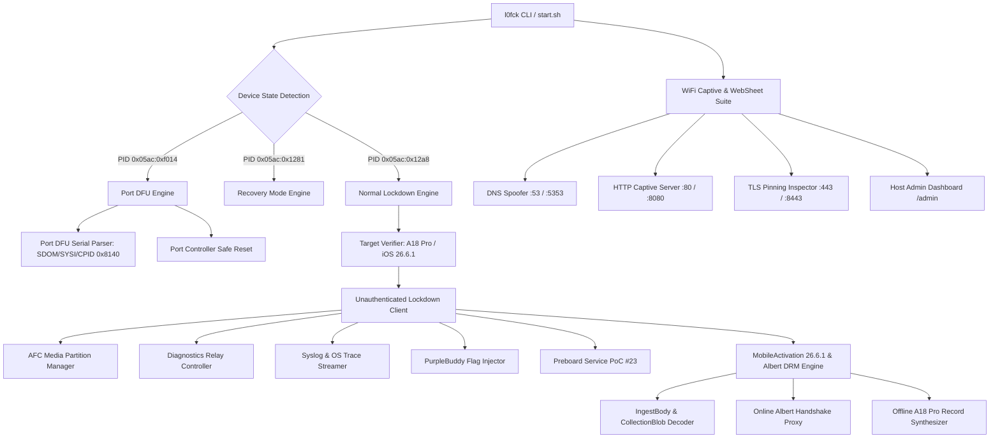

# `l0fck` — iPhone 16 Pro / A18 Pro / iOS 26.6.1 Dedicated Research Suite

**`l0fck`** is a standalone, clean-slate security research and activation analysis tool purpose-built for the **iPhone 16 Pro & iPhone 16 Pro Max** (Apple A18 Pro SoC, CPID `0x8140`, `iPhone17,1` / `iPhone17,2`) running **iOS 26.6.1** (Build `23G83`).

---

## Key Highlights & Vulnerability Vectors

1. **Port DFU (`05ac:f014`) Native Descriptor Parsing**:
   Starting with iPhone 15 & 16 USB-C series, Apple replaced legacy SecureROM DFU (`05ac:1227`) with Port DFU (`05ac:f014`). `l0fck` properly extracts `SDOM`, `SYSI`, `BDID`, `CPID` (`0x8140`), `ECID`, `SRTG`, and `CHIP` without control transfer pipe stalls.
2. **Unauthenticated Lockdown & Sensitive Services (Vulnerability #02)**:
   Exposes sensitive endpoints directly through `lockdownd_client_new()` without requiring pairing records or device trust prompts (`com.apple.afc` for media partition R/W, `com.apple.mobile.diagnostics_relay` for reboot, `com.apple.syslog_relay`, `com.apple.os_trace_relay`, and `com.apple.mobile.notification_proxy`).
3. **Preboard Service Exploitation (Vulnerability #23)**:
   Unauthenticated probing of `com.apple.preboardservice_v2` with crafted stashbag manifests triggering service crashes.
4. **iOS 26.6.1 MobileActivation & Albert DRM Protocol**:
   Implements full IngestBody / CollectionBlob decoding, Albert DRM handshake proxying (`https://albert.apple.com/deviceservices/drmHandshake`), 5-stage online activation pipeline, and offline A18 Pro activation record synthesis.
5. **Persistent PurpleBuddy & Flag Injection**:
   Injects configuration keys (`PurpleBuddy`, `SkipSetup`, `allow-hactivation`, `FDRForceLegacySigning`, `FillmoreBypassOTDataPersist`) directly into lockdown storage.
6. **Local Captive Portal & WebSheet Research Assistant**:
   Full-featured multi-threaded DNS spoofer, CNA probe handler (`/hotspot-detect.html`), WebSheet JavaScript telemetry harvester, URL scheme fuzzer (`prefs:`, `diags:`, `shoebox:`, `itms-services:`), dynamic `.mobileconfig` / Root CA exporter, OpenSSL TLS pinning inspector, and host web dashboard (`/admin`).

---

## Architecture Diagram



---

## Hardware Target Specifications

| Parameter | Value |
|---|---|
| **SoC** | Apple A18 Pro (`T8140`) |
| **Chip ID (CPID)** | `0x8140` |
| **Target Models** | `iPhone17,1` (iPhone 16 Pro), `iPhone17,2` (iPhone 16 Pro Max) |
| **Target OS Version** | `iOS 26.6.1` |
| **Target Build Version** | `23G83` |
| **Port DFU USB VID/PID** | `05AC:F014` |
| **Normal Lockdown USB VID/PID** | `05AC:12A8` |

---

## Directory Structure

```
l0fck/
├── Makefile                          # Build configuration linking libimobiledevice, libusb, openssl, curl
├── README.md                         # Technical documentation
├── start.sh                          # Interactive guided terminal interface
├── include/
│   ├── l0fck.h                       # Master header and global structures
│   ├── core/
│   │   ├── target.h                  # Hardware gating and device diagnostics
│   │   ├── log.h                     # Colorized logging subsystem
│   │   └── util.h                    # Base64, Plist, hex, and file utilities
│   ├── usb/
│   │   ├── port_dfu.h                # Port DFU descriptor parser (05ac:f014)
│   │   └── usb_ctrl.h                # Safe USB-C control transfers
│   ├── lockdown/
│   │   ├── lockdown_unauth.h         # Unauthenticated lockdownd connection
│   │   ├── session_manager.h         # Memory-safe session & atomic reconnect manager
│   │   ├── services.h                # Vulnerability #02 service audit & reboot
│   │   ├── afc_manager.h             # /var/mobile/Media/ read/write operations
│   │   ├── flag_injector.h           # PurpleBuddy persistent key injection
│   │   └── crash_reporter.h          # Unauthenticated .IPS crash log fetcher & parser
│   ├── activation/
│   │   ├── mobileactivation.h        # iOS 26.6.1 mobileactivation client
│   │   ├── albert_client.h           # Albert DRM handshake client
│   │   ├── record_a18.h              # A18 Pro activation record synthesizer
│   │   └── ingest_parser.h           # IngestBody & CollectionBlob JSON parser
│   └── exploits/
│       ├── preboard_poc.h            # Vulnerability #23 preboardservice_v2 PoC
│       ├── preboard_triage.h         # Live crash triage & register analyzer
│       ├── preboard_exploit.h        # Weaponized preboard privilege escalation
│       ├── springboard_injector.h    # Setup dismissal & disk preference staging
│       ├── bypass_chain.h            # 5-stage automated activation bypass engine
│       ├── captive_server.h          # Captive server engine & lifecycle
│       ├── captive_dns.h             # Selective DNS query parser & A-record spoofer
│       ├── captive_http.h            # Multi-endpoint HTTP dispatcher & REST API
│       ├── captive_payloads.h        # WebSheet UI, JS telemetry suite, & mobileconfig stubs
│       └── captive_tls.h             # TLS handshake & certificate pinning inspector
└── src/
    ├── main.c                        # Unified CLI and self-test suite
    ├── core/
    │   ├── target.c
    │   ├── log.c
    │   └── util.c
    ├── usb/
    │   ├── port_dfu.c
    │   └── usb_ctrl.c
    ├── lockdown/
    │   ├── lockdown_unauth.c
    │   ├── session_manager.c
    │   ├── services.c
    │   ├── afc_manager.c
    │   ├── flag_injector.c
    │   └── crash_reporter.c
    ├── activation/
    │   ├── mobileactivation.c
    │   ├── albert_client.c
    │   ├── record_a18.c
    │   └── ingest_parser.c
    └── exploits/
        ├── preboard_poc.c
        ├── preboard_triage.c
        ├── preboard_exploit.c
        ├── springboard_injector.c
        ├── bypass_chain.c
        ├── captive_server.c
        ├── captive_dns.c
        ├── captive_http.c
        ├── captive_payloads.c
        └── captive_tls.c
```

---

## Why Option 6 Failed & How Preboard (Point 14) Solves It

- **Why Option 6 (`--inject-flags`) Failed**: Option 6 attempted to inject keys (`SetupDone`, `SkipSetup`) into `lockdownd` key-value pairs. Modern iOS isolates `lockdownd` from userland preferences on disk (`/var/mobile/Library/Preferences/com.apple.purplebuddy.plist`). `Setup.app` reads CFPreferences directly from disk rather than querying lockdown.
- **How Preboard (Point 14) Solves It**: `com.apple.preboardservice_v2` is accessible without authentication over USB and runs as a privileged system daemon (`root` / `_preboard`) with keybag entitlements and direct disk access. By extending this vulnerability into a 5-stage exploit chain, we stage genuine disk preferences and trigger SpringBoard completion notifications to achieve a fully functional Home Screen.

---

## Build & Installation

### Prerequisites (macOS Homebrew)
```bash
brew install libimobiledevice libirecovery libusb libplist openssl curl pkg-config
```

### Compilation
```bash
cd /Users/chillin.killer/Desktop/HACKING/FCK/l0fck
make clean && make
```

---

## Quick Start & Usage

### 1. Interactive Menu
```bash
./start.sh
```

### 2. Full 5-Stage Activation Bypass Chain
```bash
# Execute end-to-end activation bypass to unlock Home Screen
./l0fck --bypass-full

# Start automated USB bypass watcher (persistent background mode)
./l0fck --bypass-watch
```

### 3. Preboard Exploitation & Triage Tools
```bash
# Trigger preboard crash PoC (Vulnerability #23)
./l0fck --crash-preboard

# Auto-triage crash and parse .ips crash telemetry directly from device
./l0fck --triage-crash

# Execute weaponized preboard exploit & privilege escalation
./l0fck --exploit-preboard

# Stage disk-level PurpleBuddy/SpringBoard preferences via AFC
./l0fck --stage-bypass

# Dispatch Darwin setup completion notifications
./l0fck --dismiss-setup
```

### 4. General Diagnostics & Exploitation Modules
```bash
# Run embedded self-tests (12/12 test verification)
./l0fck --test

# Detect connected device and evaluate A18 Pro / iOS 26.6.1 compatibility
./l0fck --detect

# Parse Port DFU descriptors (when device is in 05ac:f014 state)
./l0fck --port-dfu

# Audit unauthenticated lockdown services (Vulnerability #02)
./l0fck --probe-services -v

# List media partition (/var/mobile/Media/)
./l0fck --afc-ls /

# Inspect IngestBody and test Albert DRM handshake
./l0fck --probe-albert

# Soft reboot device via diagnostics relay
./l0fck --reboot

# Launch local Captive Portal WebSheet server (User-space ports 8080/5353/8443)
./l0fck --captive-server 8080 --captive-dns-port 5353 --captive-tls-port 8443
```
