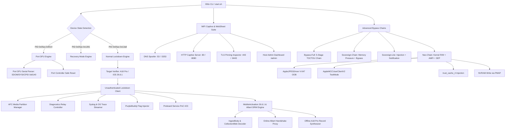

# `l0fck` — iPhone 16 Pro / A18 Pro / iOS 26.6.1 Dedicated Research Suite

**`l0fck`** is a standalone, clean-slate security research and activation analysis tool purpose-built for the **iPhone 16 Pro & iPhone 16 Pro Max** (Apple A18 Pro SoC, CPID `0x8140`, `iPhone17,1` / `iPhone17,2`) running **iOS 26.6.1** (Build `23G83`).

---

## Key Highlights & Vulnerability Vectors

1. **Port DFU (`05ac:f014`) Native Descriptor Parsing**:
   Starting with iPhone 15 & 16 USB-C series, Apple replaced legacy SecureROM DFU (`05ac:1227`) with Port DFU (`05ac:f014`). `l0fck` properly extracts `SDOM`, `SYSI`, `BDID`, `CPID` (`0x8140`), `ECID`, `SRTG`, and `CHIP` without control transfer pipe stalls.
2. **Unauthenticated Lockdown & Sensitive Services (Vulnerability #02)**:
   Exposes sensitive endpoints directly through `lockdownd_client_new()` without requiring pairing records or device trust prompts (`com.apple.afc` for media partition R/W, `com.apple.mobile.diagnostics_relay` for reboot, `com.apple.syslog_relay`, `com.apple.os_trace_relay`, and `com.apple.mobile.notification_proxy`).
3. **Preboard Service Exploitation (Vulnerability #23)**:
   Unauthenticated probing of `com.apple.preboardservice_v2` with crafted stashbag manifests triggering service crashes.
4. **iOS 26.6.1 MobileActivation & Albert DRM Protocol**:
   Implements full IngestBody / CollectionBlob decoding, Albert DRM handshake proxying (`https://albert.apple.com/deviceservices/drmHandshake`), 5-stage online activation pipeline, and offline A18 Pro activation record synthesis.
5. **Persistent PurpleBuddy & Flag Injection**:
   Injects configuration keys (`PurpleBuddy`, `SkipSetup`, `allow-hactivation`, `FDRForceLegacySigning`, `FillmoreBypassOTDataPersist`) plus expanded `com.apple.springboard`, `com.apple.SetupAssistant`, and `com.apple.purplebuddy` keys directly into lockdown storage.
6. **Local Captive Portal & WebSheet Research Assistant**:
   Full-featured multi-threaded DNS spoofer, CNA probe handler (`/hotspot-detect.html`), WebSheet JavaScript telemetry harvester, URL scheme fuzzer (`prefs:`, `diags:`, `shoebox:`, `itms-services:`), dynamic `.mobileconfig` / Root CA exporter, OpenSSL TLS pinning inspector, and host web dashboard (`/admin`).
7. **Neo-Chain Kernel Exploitation Framework**:
   Unified kernel exploit orchestration for A18 Pro (no MTE mitigation). Primary path: V-047 AppleJPEGDriver OOB write; fallback: AppleMCCUserClientV2 testMode. Integrates AMFI/CoreTrust bypass via `trust_cache_rt` injection, SEP/NVRAM write via PMAP, and proc enumeration via `allproc`. Uses verified iOS 26.6.1 T8140 offsets from `kernel-deltas/state/t8140/26.6.1-23G83.txt`.
8. **Sovereign-Chain & Sovereign-Lite Hybrid Bypass**:
   Userspace security-degradation chains that apply dual-vector memory pressure (NECP + IOSurface) and AI guardrail AFC overrides before activation bypass. Sovereign-Chain runs the full 5-stage bypass; Sovereign-Lite pivots to lockdown injection, notification burst, and respring without activation/race stages.

---

## Architecture Diagram



---

## Hardware Target Specifications

| Parameter | Value |
|---|---|
| **SoC** | Apple A18 Pro (`T8140`) |
| **Chip ID (CPID)** | `0x8140` |
| **Target Models** | `iPhone17,1` (iPhone 16 Pro), `iPhone17,2` (iPhone 16 Pro Max) |
| **Target OS Version** | `iOS 26.6.1` |
| **Target Build Version** | `23G83` |
| **Port DFU USB VID/PID** | `05AC:F014` |
| **Normal Lockdown USB VID/PID** | `05AC:12A8` |
| **Kernel Offset Source** | `kernel-deltas/state/t8140/26.6.1-23G83.txt` |

---

## Directory Structure

```
l0fck/
├── Makefile                          # Build configuration linking libimobiledevice, libusb, openssl, curl
├── README.md                         # Technical documentation
├── start.sh                          # Interactive grouped terminal menu with confirmation screens
├── include/
│   ├── l0fck.h                       # Master header and global structures
│   ├── core/
│   │   ├── target.h                  # Hardware gating and device diagnostics
│   │   ├── log.h                     # Colorized logging subsystem
│   │   └── util.h                    # Base64, Plist, hex, and file utilities
│   ├── usb/
│   │   ├── port_dfu.h                # Port DFU descriptor parser (05ac:f014)
│   │   └── usb_ctrl.h                # Safe USB-C control transfers
│   ├── lockdown/
│   │   ├── lockdown_unauth.h         # Unauthenticated lockdownd connection
│   │   ├── session_manager.h         # Memory-safe session & atomic reconnect manager
│   │   ├── services.h                # Vulnerability #02 service audit & reboot
│   │   ├── afc_manager.h             # /var/mobile/Media/ read/write operations
│   │   ├── flag_injector.h           # PurpleBuddy persistent key injection
│   │   └── crash_reporter.h          # Unauthenticated .IPS crash log fetcher & parser
│   ├── activation/
│   │   ├── mobileactivation.h        # iOS 26.6.1 mobileactivation client
│   │   ├── albert_client.h           # Albert DRM handshake client
│   │   ├── record_a18.h              # A18 Pro activation record synthesizer
│   │   └── ingest_parser.h           # IngestBody & CollectionBlob JSON parser
│   └── exploits/
│       ├── preboard_poc.h            # Vulnerability #23 preboardservice_v2 PoC
│       ├── preboard_triage.h         # Live crash triage & register analyzer
│       ├── preboard_exploit.h        # Weaponized preboard privilege escalation
│       ├── springboard_injector.h    # Setup dismissal & disk preference staging
│       ├── bypass_chain.h            # Bypass engines: full, sovereign, neo-chain
│       ├── kernel_exploit.h          # Unified kernel R/W primitive framework
│       ├── kernel_offsets.h          # iOS 26.6.1 T8140 verified kernel offsets
│       ├── amfi_bypass.h             # AMFI HSP disable & proc enumeration
│       ├── coretrust_bypass.h        # trust_cache_rt injection & validation patch
│       ├── cvmserver_exploit.h       # CVMServer cdhash registration (userspace)
│       ├── sep_bypass.h              # SEP enforcement & NVRAM activated-state write
│       ├── sandbox_escape.h          # bad_query container path traversal
│       ├── tls_bypass.h              # TLS pinning bypass for Albert/WebKit clients
│       ├── captive_server.h          # Captive server engine & lifecycle
│       ├── captive_dns.h             # Selective DNS query parser & A-record spoofer
│       ├── captive_http.h            # Multi-endpoint HTTP dispatcher & REST API
│       ├── captive_payloads.h        # WebSheet UI, JS telemetry suite, & mobileconfig stubs
│       └── captive_tls.h             # TLS handshake & certificate pinning inspector
└── src/
    ├── main.c                        # Unified CLI and self-test suite
    ├── core/
    │   ├── target.c
    │   ├── log.c
    │   └── util.c
    ├── usb/
    │   ├── port_dfu.c
    │   └── usb_ctrl.c
    ├── lockdown/
    │   ├── lockdown_unauth.c
    │   ├── session_manager.c
    │   ├── services.c
    │   ├── afc_manager.c
    │   ├── flag_injector.c
    │   └── crash_reporter.c
    ├── activation/
    │   ├── mobileactivation.c
    │   ├── albert_client.c
    │   ├── record_a18.c
    │   └── ingest_parser.c
    └── exploits/
        ├── preboard_poc.c
        ├── preboard_triage.c
        ├── preboard_exploit.c
        ├── springboard_injector.c
        ├── bypass_chain.c            # bypass-full, sovereign, sovereign-lite, neo-chain
        ├── kernel_exploit.c
        ├── applejpegdriver_exploit.c # V-047 OOB write (primary kernel primitive)
        ├── applemcc_exploit.c        # AppleMCCUserClientV2 testMode (fallback)
        ├── amfi_bypass.c
        ├── coretrust_bypass.c
        ├── cvmserver_exploit.c
        ├── sep_bypass.c
        ├── sandbox_escape.c
        ├── tls_bypass.c
        ├── captive_server.c
        ├── captive_dns.c
        ├── captive_http.c
        ├── captive_payloads.c
        └── captive_tls.c
```

---

## Interactive Menu (`start.sh`)

The interactive interface has been redesigned into grouped sections with confirmation screens. Before every action, the menu shows the command, required device state, risk level, documentation summary, and ASCII flow diagram, then prompts `Proceed? [Y/n]:`.

| Section | Contents |
|---|---|
| **1. Device Discovery** | `--detect`, `--port-dfu`, `--usb-scan` |
| **2. Lockdown / AFC** | `--probe-services`, `--afc-ls`, `--inject-flags`, `--verify-flags`, `--syslog`, `--reboot` |
| **3. Activation / Albert** | `--probe-albert`, `--activate-online`, `--activate-race`, `--deactivate` |
| **4. Preboard / Setup Assistant** | `--crash-preboard`, `--triage-crash`, `--stage-bypass`, `--exploit-preboard` |
| **5. Captive Portal** | `--captive-server`, `--export-profile` |
| **6. Advanced Chains** | `--bypass-full`, `--bypass-watch`, `--sovereign`, `--sovereign-lite`, `--neo-chain` |
| **7. Diagnostics** | `--test`, `--test-kernel-exploit`, `--test-amfi-bypass` |

```bash
./start.sh
```

---

## Bypass Chain Comparison

| Chain | CLI Flag | Stages | Kernel Exploit | Activation Race |
|---|---|---|---|---|
| **Bypass-Full** | `--bypass-full` | AFC staging → online/VUL 23 race → triage → notifications → SpringBoard | No | Yes |
| **Bypass-Watch** | `--bypass-watch` | Auto-triggers bypass-full on USB connect | No | Yes |
| **Sovereign-Chain** | `--sovereign` | Memory pressure → AI guardrails → bypass-full | No | Yes |
| **Sovereign-Lite** | `--sovereign-lite` | Memory pressure → AI guardrails → flag injection → notifications → respring | No | No |
| **Neo-Chain** | `--neo-chain` | Recon → kernel R/W → AMFI/CoreTrust → SEP/NVRAM → persistence → verify | Yes | No |

### Neo-Chain Stages (`--neo-chain`)

```
Stage 0: Recon (A18 Pro detection, MTE absence confirmation)
Stage 1: Kernel R/W (V-047 AppleJPEGDriver OOB, fallback: MCC testMode)
Stage 2: AMFI / CoreTrust (CVMServer cdhash + trust_cache_rt injection)
Stage 3: SEP / MobileActivation (NVRAM write via PMAP; SEP mailbox blocked)
Stage 4: Persistence (AFC staging; IOMFB NVMe EAN blocked)
Stage 5: Cleanup (Darwin notifications, respring, verification)
```

Blocked exploit paths (DarkSword pe_v2, PUAF, `proc.p_flag`, IOMFB EAN, mobileactivationd patch) are tracked in `PLAN/awaiting_offsets.txt`.

---

## Why Option 6 Failed & How Preboard (Point 14) Solves It

- **Why Option 6 (`--inject-flags`) Failed**: Option 6 attempted to inject keys (`SetupDone`, `SkipSetup`) into `lockdownd` key-value pairs. Modern iOS isolates `lockdownd` from userland preferences on disk (`/var/mobile/Library/Preferences/com.apple.purplebuddy.plist`). `Setup.app` reads CFPreferences directly from disk rather than querying lockdown.
- **How Preboard (Point 14) Solves It**: `com.apple.preboardservice_v2` is accessible without authentication over USB and runs as a privileged system daemon (`root` / `_preboard`) with keybag entitlements and direct disk access. By extending this vulnerability into a 5-stage exploit chain, we stage genuine disk preferences and trigger SpringBoard completion notifications to achieve a fully functional Home Screen.

---

## Build & Installation

### Prerequisites (macOS Homebrew)
```bash
brew install libimobiledevice libirecovery libusb libplist openssl curl pkg-config
```

### Compilation
```bash
cd /Users/chillin.killer/Desktop/HACKING/FCK/l0fck
make clean && make
```

---

## Quick Start & Usage

### 1. Interactive Menu
```bash
./start.sh
```

### 2. Full 5-Stage Activation Bypass Chain
```bash
# Execute end-to-end activation bypass to unlock Home Screen
./l0fck --bypass-full

# Start automated USB bypass watcher (persistent background mode)
./l0fck --bypass-watch
```

### 3. Sovereign-Chain & Sovereign-Lite
```bash
# Hybrid security degradation: memory pressure + AI guardrails + full bypass chain
./l0fck --sovereign

# Lightweight variant: memory pressure + AI guardrails + flag injection + notifications + respring
./l0fck --sovereign-lite
```

### 4. Neo-Chain Kernel Exploitation
```bash
# Full Neo-Chain: kernel R/W -> AMFI/CoreTrust -> SEP/NVRAM -> persistence -> verify
./l0fck --neo-chain

# Isolated kernel R/W primitive test (V-047, MCC fallback, allproc probe)
./l0fck --test-kernel-exploit

# Isolated AMFI/CoreTrust bypass test (proc walk + trust_cache_rt injection)
./l0fck --test-amfi-bypass
```

### 5. Preboard Exploitation & Triage Tools
```bash
# Trigger preboard crash PoC (Vulnerability #23)
./l0fck --crash-preboard

# Auto-triage crash and parse .ips crash telemetry directly from device
./l0fck --triage-crash

# Execute weaponized preboard exploit & privilege escalation
./l0fck --exploit-preboard

# Stage disk-level PurpleBuddy/SpringBoard preferences via AFC
./l0fck --stage-bypass

# Dispatch Darwin setup completion notifications
./l0fck --dismiss-setup
```

### 6. General Diagnostics & Exploitation Modules
```bash
# Run embedded self-tests (12/12 test verification, host-only)
./l0fck --test

# Detect connected device and evaluate A18 Pro / iOS 26.6.1 compatibility
./l0fck --detect

# Parse Port DFU descriptors (when device is in 05ac:f014 state)
./l0fck --port-dfu

# Audit unauthenticated lockdown services (Vulnerability #02)
./l0fck --probe-services -v

# List media partition (/var/mobile/Media/)
./l0fck --afc-ls /

# Inspect IngestBody and test Albert DRM handshake
./l0fck --probe-albert

# Soft reboot device via diagnostics relay
./l0fck --reboot

# Launch local Captive Portal WebSheet server (User-space ports 8080/5353/8443)
./l0fck --captive-server 8080 --captive-dns-port 5353 --captive-tls-port 8443
```

---

## Kernel Offsets (iOS 26.6.1 / T8140)

Neo-Chain components use verified non-zero offsets from `kernel-deltas/state/t8140/26.6.1-23G83.txt`. Key symbols:

| Symbol | Address |
|---|---|
| `kalloc_data_external` | `0xfffffff00a6cc6f8` |
| `kfree_data_external` | `0xfffffff00a6cce30` |
| `allproc` | `0xfffffff00b23a880` |
| `trust_cache_rt` | `0xfffffff007cdab20` |
| `load_static_trust_cache` | `0xfffffff00abe4888` |
| `pmap_enter_options_addr` | `0xfffffff00a80f198` |
| `str_x8_x0` (gadget) | `0xfffffff00a68c33c` |

Unresolved offsets (`proc.p_flag`, thread machine fields, SEP mailbox, IOMFB EAN) are documented in `PLAN/awaiting_offsets.txt`. Deprecated iOS 26.0.x offsets from Apple-Bug-Bounty-Skill must not be used.

---

## Recent Changes (since last push)

- **Neo-Chain framework**: kernel exploit orchestration, AMFI/CoreTrust/SEP modules, CLI flags (`--neo-chain`, `--test-kernel-exploit`, `--test-amfi-bypass`)
- **Sovereign-Chain / Sovereign-Lite**: hybrid security-degradation bypass chains (`--sovereign`, `--sovereign-lite`)
- **Interactive menu redesign**: grouped 7-section menu with per-action confirmation screens, documentation, and ASCII flow diagrams
- **Expanded flag injection**: additional `com.apple.purplebuddy`, `com.apple.springboard`, and `com.apple.SetupAssistant` keys
- **Expanded notification burst**: additional FUD/UARP/update notifications, 5 burst cycles (was 2), 30ms spacing (was 15ms)
